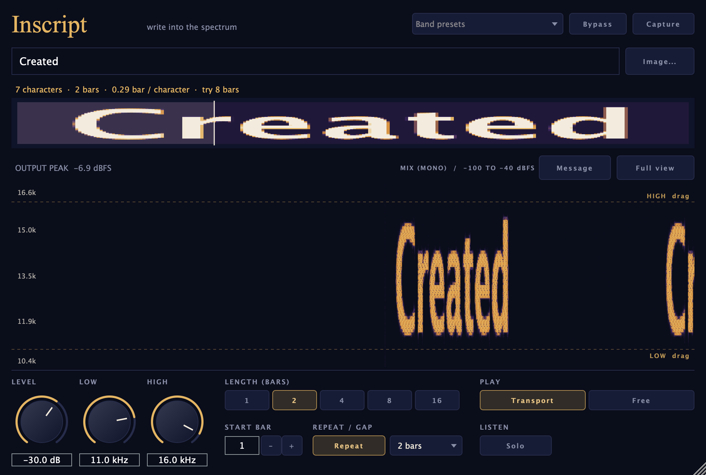

# Inscript

**Hidden messages in the spectrum.** Type a word (or drop in an image) and Inscript writes it into your track as a quiet
band of tones. You'll barely hear it, but open the song in a spectrogram and the message is there, written in
light. Inscript shows its own live spectrogram, so you can watch the letters appear as the song plays.

AU · VST3 · Standalone — macOS (Windows VST3 builds in CI) — by [Rhizr](https://rhizr.dev/music), built with [JUCE](https://juce.com)



[Capture layout](docs/capture.png)

## Features

- **Text or image**: type up to 64 characters, or drop a PNG/JPG on the window; bright parts sound, dark parts stay quiet
- **Band**: Low and High set which frequencies the message is written in (the bottom and top of the letters).
  Presets for *Hidden* (11–16 kHz), *Faint* (16–19 kHz), *Visible* (2–12 kHz) and *Low*
- **Level**: -60 to -12 dB. Under a full mix, -30 dB in the top band is very hard to hear
- **In time with the song**: pick the start bar and how many bars the message lasts (1–16), and whether it repeats
  after a gap. With **Play: Transport** it follows the song position, so every bounce comes out the same;
  **Free** loops all the time, even when stopped, for trying things out
- **Live spectrogram** zoomed to the message band by default, with full-range and mix/message views. The message
  view shows only the added tones; the mix view shows a mono fold of the processed output. Drag the band edges on the display or
  type precise frequencies into the Low and High fields
- **Timing preview** shows the message, playhead, length and space per character; Capture mode enlarges the visual
  for recording a reel
- **Output sample peak** warns if the processed signal exceeds 0 dBFS; Inscript does not limit or attenuate the mix
- **Solo** to hear only the message; click-free bypass; the message (text or image) is saved with your session

The DAW listing is **Rhizr → Inscript**. The bundle filenames (`01.component` and `01.vst3`), plugin IDs and
parameter IDs remain the same so projects made with 01 can find the plugin after updating.

## Reading the message back

Open the bounced file in any spectrogram with a **linear** frequency scale: [Audacity](https://www.audacityteam.org)
(track menu → Spectrogram, then set the scale to Linear in Spectrogram Settings), [Spek](https://www.spek.cc),
Sonic Visualiser or iZotope RX. Zoom to the message band and adjust the display range; a quiet message can be
hard to see when the whole 0–24 kHz spectrum shares one colour scale.

Leave headroom before Inscript, especially on a limited mix. It adds tones to the incoming audio and does not limit
the result. Place it before the final limiter or lower the input enough that the finished export stays below
full scale. On a dense Something New excerpt, the title was hard to read over the default two bars. Spreading
it over eight bars made both 11–16 kHz and 16–19 kHz readable in local 256 kbps AAC tests when the display
was zoomed to the message band. Check the timing, band and level against your own track.

For a lossy export, start with the *Hidden* preset (11–16 kHz) and inspect the final file. Codec, bitrate,
sample rate, mastering and each service's transcoding can change the result. In a local 256 kbps AAC test,
both *Hidden* and *Faint* (16–19 kHz) remained visible, with *Faint* weaker. That test does not guarantee
either band survives a streaming service's processing.

## Install

### Download

Get the latest zip for your system from [Releases](https://github.com/matiasconcha11/01/releases/latest).

**macOS**: unzip and move the plugin into place:
- AU (Logic, GarageBand): `01.component` → `~/Library/Audio/Plug-Ins/Components/`
- VST3 (Ableton, Reaper, etc.): `01.vst3` → `~/Library/Audio/Plug-Ins/VST3/`

The builds aren't notarized by Apple yet, so macOS blocks them at first. Clear the download flag in Terminal:
```
xattr -dr com.apple.quarantine ~/Library/Audio/Plug-Ins/Components/01.component ~/Library/Audio/Plug-Ins/VST3/01.vst3
```
Then restart your DAW and look for **Rhizr → Inscript**.

**Windows**: unzip and move `01.vst3` into `C:\Program Files\Common Files\VST3\`. (The Windows build is
compiled and unit-tested automatically but hasn't been tried in a DAW yet.)

### Build from source

1. Install Xcode (or its Command Line Tools) and the build tools:
   ```
   xcode-select --install
   brew install cmake ninja
   ```
2. Build:
   ```
   git clone https://github.com/matiasconcha11/01.git
   cd 01
   make
   ```

The build installs the plugin into `~/Library/Audio/Plug-Ins/` (AU in `Components`, VST3 in `VST3`).

## Development

```
make            # Release build, installed into ~/Library/Audio/Plug-Ins/
make test       # unit tests (Catch2)
make validate   # pluginval at strictness 10 (VST3 + AU)
make check      # both
./build/ZeroOneTests "[.snapshot]"   # renders the editor to /tmp/zeroone.png (ZEROONE_SNAPSHOT to change)
```

How it works: the message is a 48-row picture. Each row is a band of three sine oscillators between Low and High
(the top row is the highest), and each column of the picture sets the rows' levels for one slice of the message's
length, with 2 ms fades so the edges stay sharp without clicking.

## License

[AGPL-3.0](LICENSE)
